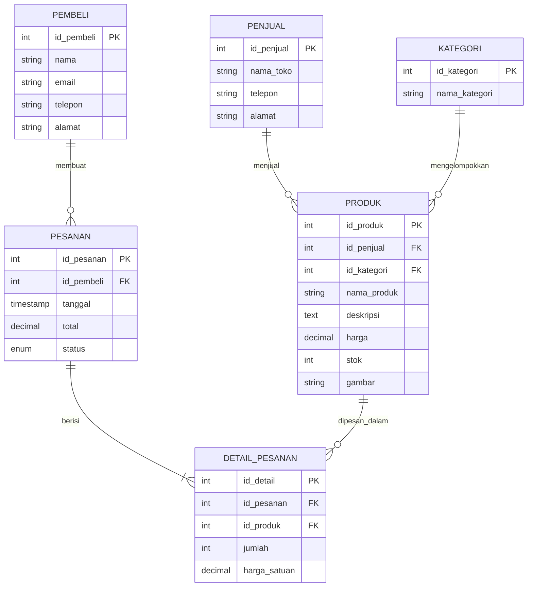
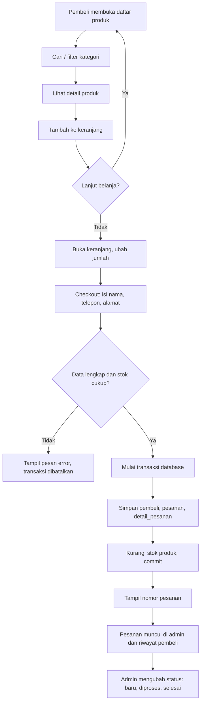

# Dokumen Perancangan Web Marketplace

## a. Identifikasi Entitas
| Entitas | Peran dalam sistem |
|---|---|
| Penjual | Pemilik toko yang menawarkan produk |
| Kategori | Pengelompokan produk (Elektronik, Fashion, Makanan) |
| Produk | Barang yang dijual (harga, stok, deskripsi) |
| Pembeli | Orang yang memesan; datanya diisi saat checkout |
| Pesanan | Satu transaksi pembelian (tanggal, total, status) |
| Detail_Pesanan | Rincian produk, jumlah, dan harga pada satu pesanan |

## b. Rancangan Database Relasional
| Tabel | Kolom (tipe) | PK | FK |
|---|---|---|---|
| penjual | id_penjual INT, nama_toko VARCHAR(100), telepon VARCHAR(20), alamat VARCHAR(255) | id_penjual | - |
| kategori | id_kategori INT, nama_kategori VARCHAR(50) | id_kategori | - |
| produk | id_produk INT, id_penjual INT, id_kategori INT, nama_produk VARCHAR(150), deskripsi TEXT, harga DECIMAL, stok INT, gambar VARCHAR(255) | id_produk | id_penjual -> penjual, id_kategori -> kategori |
| pembeli | id_pembeli INT, nama VARCHAR(100), email VARCHAR(100), telepon VARCHAR(20), alamat VARCHAR(255) | id_pembeli | - |
| pesanan | id_pesanan INT, id_pembeli INT, tanggal TIMESTAMP, total DECIMAL, status ENUM(baru, diproses, selesai) | id_pesanan | id_pembeli -> pembeli |
| detail_pesanan | id_detail INT, id_pesanan INT, id_produk INT, jumlah INT, harga_satuan DECIMAL | id_detail | id_pesanan -> pesanan, id_produk -> produk |

### Hubungan Antar-Tabel
| Hubungan | Kardinalitas | Penjelasan |
|---|---|---|
| penjual - produk | 1 : N | Satu penjual punya banyak produk |
| kategori - produk | 1 : N | Satu kategori berisi banyak produk |
| pembeli - pesanan | 1 : N | Satu pembeli bisa membuat banyak pesanan (dasar riwayat pembelian) |
| pesanan - detail_pesanan | 1 : N | Satu pesanan berisi banyak baris detail |
| produk - detail_pesanan | 1 : N | Satu produk bisa muncul di banyak pesanan |
| pesanan - produk | M : N | Diselesaikan oleh tabel perantara detail_pesanan |

`harga_satuan` disimpan di detail_pesanan agar riwayat tidak berubah ketika harga produk diubah.

## c. ERD


## d. Alur Proses Transaksi


## e. Mockup UI (sketsa)
**Daftar produk**
```
[Marketplace]            [Riwayat] [Keranjang 2] [Admin]
+-----------------------------------------------------+
|  Belanja mudah, harga bersahabat                    |
|  [ Cari produk...........][Terbaru v][Cari]         |
+-----------------------------------------------------+
(Semua) (Elektronik) (Fashion) (Makanan)
+--------+ +--------+ +--------+ +--------+
| gambar | | gambar | | gambar | | gambar |
| Nama   | | Nama   | | Nama   | | Nama   |
| Rp xxx | | Rp xxx | | Rp xxx | | Rp xxx |
|[Detail][+Tambah]   ...
```
**Detail produk**
```
Beranda / Kategori / Nama Produk
+---------------+  Nama Produk
|    gambar     |  Rp 150.000
|               |  Toko | Stok
+---------------+  Deskripsi ...
                   [ - 1 + ] [Tambah ke Keranjang]
```
**Keranjang belanja**
```
+--------------------------------------+  +-------------+
| [img] Nama  Rp  [ - 2 + ]  Rp  [hapus]|  | Ringkasan   |
| [img] Nama  Rp  [ - 1 + ]  Rp  [hapus]|  | Total Rp xx |
+--------------------------------------+  | [Checkout]  |
```
**Admin - Pesanan & Riwayat Pembeli**
```
[Produk] [Pesanan & Riwayat Pembeli]      [Cari nama/telepon][status][Filter]
Pesanan #7 [baru]            Rp 235.000   [status v][Simpan]
Budi | 0812.. | alamat       Headset x1 ... Rp 150.000
```
